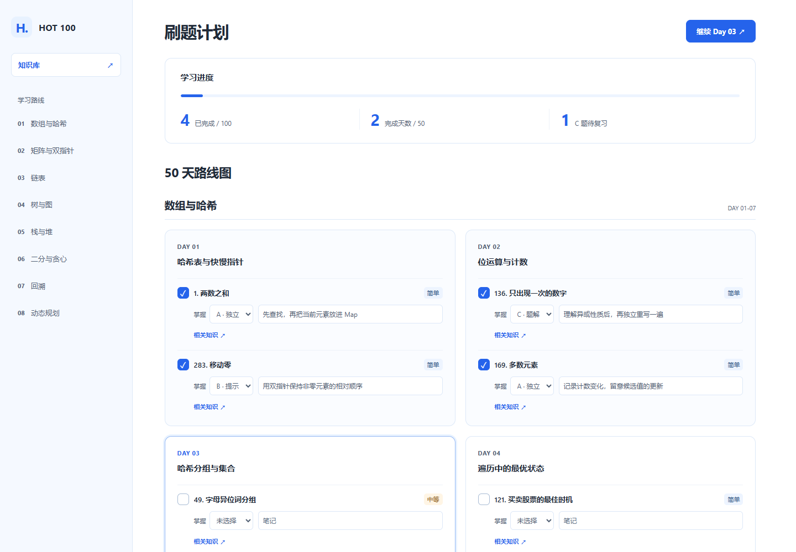
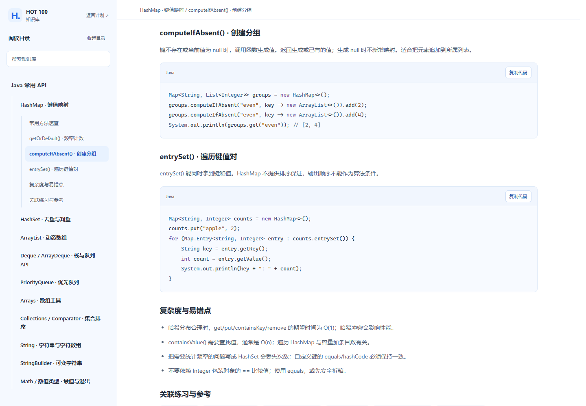
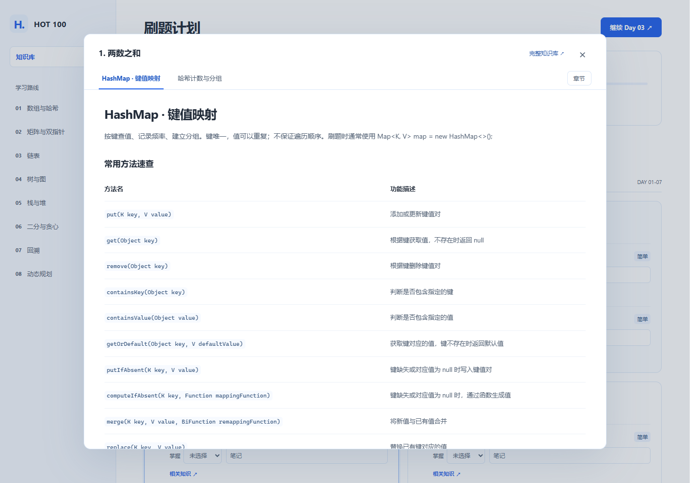

# Hot 100 刷题小工具

一个适合 Java 刷题新手的本地小工具，把力扣 Hot 100 安排成 50 个 Day，每个 Day 两道题。

如果你已经会一些 Java 基础语法，但刚开始刷 Hot 100，不知道先做哪道、遇到不会的知识点该去哪查，这个项目可以帮你把每天要做的事安排清楚。题目按前置知识分阶段编排，从数组与哈希开始，逐步练到树与图、回溯和动态规划，一块一块地学。

它做的事情很简单：安排题目、查相关知识、记录进度和卡点。每天按自己的节奏练两道，做完留下一点复盘，下一次打开接着练。

## 能帮你省哪些事

| 刚开始刷题时的困扰 | 这里提供的帮助 |
| --- | --- |
| 面对 100 道题，不知道从哪里开始 | 提前安排好 8 个阶段、50 个 Day，按学习顺序练习 |
| 一次想刷太多，过几天又停下来 | 每个 Day 两道题，忙的时候可以顺延 |
| HashMap、队列、二分这些知识不熟，刷题时来回查 | 内置 Java API、基础算法与数据结构、解题思想知识库 |
| 题做过了，却忘了当时卡在哪里 | 记录掌握程度和一句复盘笔记，方便之后挑题重做 |

## 功能与界面

以下截图使用示例学习记录，展示的是项目实际页面。

### 每天两题，按模块往下练

首页按 Day 展示题目，左侧可以切换学习阶段。路线包含数组与哈希、矩阵与双指针、链表、树与图、栈与堆、二分与贪心、回溯、动态规划这 8 个阶段。

点击题名去力扣做题，回来后勾选完成情况、选择掌握程度、记下卡点。顶部能看到已完成题数、完成天数和 C 题数量；“继续 Day”会带你找到下一组未完成的题目。



### 知识库：忘了用法，随时查一下

知识库分为“Java 常用 API”“基础算法与数据结构”“解题思想”三类，包含方法速查、Java 示例、示例推演、复杂度和易错点。

侧边栏可以按层级展开目录，也可以搜索标题、正文和代码。代码支持复制，适合在刷题时查用法、回看模板。



### 相关知识：从题目直接找到要补的内容

每道题旁边都有“相关知识”入口。例如“两数之和”可以直接查看 HashMap 和哈希计数的相关内容，省去自己在目录里找的步骤。

弹窗里可以切换知识点、打开章节目录。点击“完整知识库 ↗”会在当前标签页进入对应知识点；浏览器后退时，会恢复原题位置、弹窗、所选知识点和弹窗阅读位置。



## 文件结构

下面列出主要文件。Windows Release 包已包含 `start.exe` 和 `stop.exe`；下载源码时，这两个文件需要在本地生成。`data/progress.json` 会在首次保存时创建。

```text
hot100-tracker/
├── README.md
├── hot100-50-day-plan.md   # 50 天题单，决定学习阶段和题目安排
├── server.js              # 本地服务，读取题单并保存进度
├── start.cmd              # Windows 命令行启动入口
├── build-launchers.cmd    # 生成 Windows 启动器和停止入口
├── start.exe              # Release 已提供，双击启动，不弹命令窗口
├── stop.exe               # Release 已提供，双击停止后台服务
├── launcher/
│   └── Launcher.cs        # Windows 启动器源码
├── public/
│   ├── index.html         # 刷题计划首页
│   ├── app.css            # 首页样式和共享配色
│   ├── app.js             # 进度统计、勾选、掌握程度和笔记
│   ├── knowledge.html     # 知识库页面
│   ├── knowledge.css      # 知识库和相关知识弹窗样式
│   ├── knowledge.js       # 目录、搜索、阅读和弹窗交互
│   └── knowledge-data.js  # 知识点内容与题目的关联
├── assets/
│   └── screenshots/       # README 的界面截图
├── data/
│   └── progress.json      # 完成情况、掌握程度和复盘笔记
└── tests/                 # 知识点、浏览器和启动器验证脚本
```

## 下载与启动

### Windows：下载 Release 后使用

日常刷题推荐下载 Release 中的 Windows 轻量完整版。它包含完整功能和预编译启动器，不附带 Node.js。

1. 先从 [Node.js 官网](https://nodejs.org/zh-cn) 安装 Node.js。已安装的同学可以跳过这一步。
2. 打开 [Releases 下载页面](https://github.com/haitow/hot100-tracker/releases/latest)，在 **Assets** 中下载名称类似 `hot100-tracker-v0.2.0-windows.zip` 的完整包。GitHub 自动提供的 `Source code` 附件供源码开发使用。
3. 把 ZIP 完整解压到一个可以写入的目录，进入包含 `server.js` 和 `start.exe` 的文件夹。
4. 双击 `start.exe`，服务会在后台启动，并打开默认浏览器，启动时不会弹出命令窗口。

Release 包无需自行编译启动器，也不需要运行 `npm install`、配置数据库或构建前端。请完整解压后启动，不要直接在压缩包内双击程序。

如果不确定 Node.js 是否安装成功，可以在新打开的终端中检查：

```powershell
node -v
```

### 再次进入和停止服务

- 关闭网页后，服务仍在运行。想再次进入，双击同一个 `start.exe` 即可，它会复用已启动的服务。
- 不再使用时，双击项目目录中的 `stop.exe` 停止服务。
- 两个 `.exe` 文件需要留在项目目录，可以为它们创建桌面快捷方式。

### 命令行启动

在项目根目录运行：

```powershell
node server.js
```

Windows 也可以双击 `start.cmd`。没有自动打开浏览器时，打开终端输出的地址即可。命令行启动新服务后，需要保持终端窗口开启；按 `Ctrl+C` 可以停止该服务。

服务只监听本机 `127.0.0.1`，端口会自动选择，不需要自己指定固定端口。

## 每天怎么用

1. 点击“继续 Day”，打开下一组未完成的题目。
2. 点击题名，到力扣独立思考并提交。知识点不熟时，可以先看“相关知识”。
3. 做完后回来勾选，按实际情况选择掌握程度：

   | 标记 | 含义 |
   | --- | --- |
   | A | 独立完成 |
   | B | 提示后完成 |
   | C | 看题解后重写 |

4. 在笔记里写一句卡点，例如“二分的右边界更新写错了”。写完后点击输入框以外的位置，笔记会自动保存。
5. 后续复习时，优先回看 C 题和记过卡点的题目，再尝试独立重做。

Day 表示学习顺序，不是日历日期。当天没做完可以顺延；只有一个 Day 的两道题都勾选完成，才会计入“完成天数”。目前页面显示 C 题数量，复习时间需要自己安排，没有自动提醒。

## 进度保存与备份

完成情况、掌握程度和笔记保存在 `data/progress.json`，首次保存时自动创建。关闭网页或重启服务后，学习记录仍会从这个文件读取。

- **保存失败时先处理提示。** 正常保存不会额外弹窗；如果页面显示“保存失败”，先确认服务还在运行、项目目录可以写入。
- **换电脑或备份时，保留进度文件。** 把 `data/progress.json` 放回对应项目目录，就能继续读取之前的记录。
- **使用源码仓库同步 GitHub 时，由自己提交和推送。** 项目没有忽略进度文件，本地自动保存不会替你执行 Git 操作。
- **在页面上勾选完成，不修改题单里的勾选框。** `hot100-50-day-plan.md` 中的题目行需要保持 `- [ ]`，改成 `- [x]` 会影响当前解析器读取。

知识库的阅读位置和目录状态使用浏览器本地存储，在同一次服务运行期间可以恢复；重新启动服务后会重置。它们与保存在文件里的学习进度分开。

## 升级版本

1. 先停止旧版本服务：使用 `stop.exe`，或在旧版本的命令行窗口中按 `Ctrl+C`。
2. 将旧目录中的 `data/progress.json` 备份到另一个位置。如果还没有保存过记录，可以跳过这一步。
3. 从 Releases 下载新版完整 ZIP，解压到一个新目录。
4. 如果要继续原来的进度，在新目录中创建 `data/` 文件夹，将备份的 `progress.json` 放进去，再双击新版 `start.exe`。

发布包从零进度开始，不含作者的学习记录。自己的完成情况、掌握程度和笔记需要通过上述进度文件保留。

## 常见问题

**找不到 Node.js 或启动失败**

先用 `node -v` 检查安装情况。Windows 下可以运行 `start.cmd` 查看具体错误；无窗口启动的错误日志位于 `.runtime/launcher.log`，后台服务日志位于 `.runtime/server.log`。

**从旧版本的命令行启动方式切换过来**

如果旧版本服务仍在命令窗口中运行，先关闭那一个旧窗口，再使用新启动器。当前版本的命令行服务和启动器可以识别并复用同一项目已经启动的服务。

**题目在哪提交，项目里有没有完整题解？**

点击题名后，在力扣页面编写代码并提交。本项目负责学习安排、知识查询和进度记录；知识库提供通用方法与示例，完整题解需要自行查阅。

## 开发检查

### 从源码运行

准备修改代码时，可以克隆仓库或下载源码，在包含 `server.js` 的项目根目录操作。源码仓库没有预编译的 `start.exe` 和 `stop.exe`。

直接运行 `node server.js` 或 Windows 下的 `start.cmd` 即可启动。如果希望使用无命令窗口的启动方式，在 Windows 下执行一次：

```powershell
.\build-launchers.cmd
```

这会使用 Windows .NET Framework 的 C# 编译器生成两个启动器。之后双击 `start.exe` 使用即可；编译器不可用时，可以继续用命令行启动。

### 基础检查

页面使用原生 HTML、CSS 和 JavaScript，本地服务使用 Node.js 内置模块，没有第三方运行时依赖。修改代码后，可以在项目根目录做基础检查：

```powershell
node --check server.js
node --check public/app.js
node --check public/knowledge.js
node --check public/knowledge-data.js
git diff --check
```

如果只想启动服务、手动打开页面：

```powershell
node server.js --no-open
```

完整验证脚本位于 `tests/`。浏览器验证需要提供 Playwright 和浏览器路径，Java 示例验证需要 JDK；日常使用不需要安装这些验证工具。涉及保存的测试应在隔离副本中运行，避免改动自己的学习记录。
